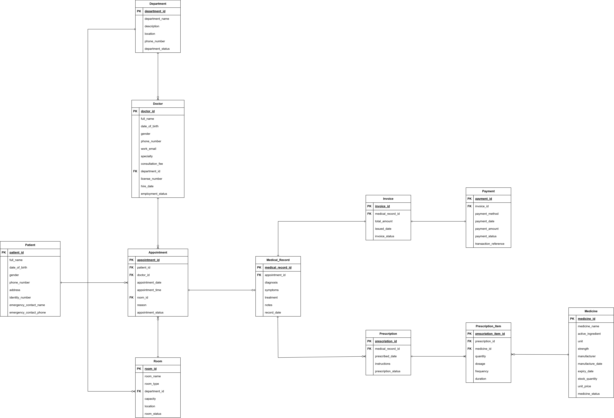

# Hospital Management System

A production-style Hospital Management System built from scratch to learn database design and data engineering, following a real-world process — from requirement gathering to a working PostgreSQL database with tested constraints, indexes, views, synthetic data (clean and dirty), and business-scenario SQL queries.

It is the hands-on project of a self-designed Data Engineering roadmap, leading toward ETL / Data Warehouse work.



## Tech Stack

- **Database:** PostgreSQL
- **Migrations:** Flyway
- **Data generation:** Python (SQLAlchemy)
- **Client tool:** DBeaver
- **Version control:** Git / GitHub
- **Diagramming:** draw.io (crow's foot notation)
- **Editor:** VS Code

## Getting Started

### Requirements

- PostgreSQL (with an empty database, e.g. `hospital_management`)
- [Flyway](https://documentation.red-gate.com/flyway) CLI
- Python 3 (only needed for the data generator)

### 1. Create the schema (Flyway)

Copy `flyway.toml.example` to `flyway.toml` and fill in your own connection details (never commit real passwords; `flyway.toml` is gitignored). The migrations location is `sql/migrations`.

```bash
flyway info      # lists migrations; "Pending" means not applied yet
flyway migrate   # applies all pending migrations in version order (V001 → V068)
```

If a run stops halfway, fix the problem and run `flyway migrate` again — it continues from the first pending migration. (`flyway baseline` is only for a database that already has tables but was never managed by Flyway.)

### 2. Generate data (Python)

Create a `.env` file in the project root (gitignored) with the connection used by the generator:

```
DB_HOST=localhost
DB_PORT=5432
DB_NAME=hospital_management
DB_USER=postgres
DB_PASSWORD=your_password
```

Run the generators in foreign-key dependency order (parents before children). Each one is idempotent — running it again only adds what is missing:

```bash
python -m data_generator.generators.department
python -m data_generator.generators.patient
python -m data_generator.generators.medicine
python -m data_generator.generators.doctor
python -m data_generator.generators.room
python -m data_generator.generators.appointment
python -m data_generator.generators.medical_record
python -m data_generator.generators.prescription
python -m data_generator.generators.prescription_item
python -m data_generator.generators.invoice
python -m data_generator.generators.payment
```

Volumes and rates (number of patients, share of completed/cancelled appointments, paid invoices...) live in `data_generator/config.py`.

### 3. Inject dirty data (last step)

```bash
python -m data_generator.dirty_data
```

This step **must run last**: it edits rows the generators already created (corrupts some phone numbers, appointment times, record and payment dates, status spellings, and adds duplicate patients). Running it earlier would make later generators build on already-corrupted data. A guard skips the step if the data was already injected, but it only protects a rebuild of the database, not partial manual runs.

## Highlights

- **11 normalized tables (3NF)** with deliberate PostgreSQL data types (`DECIMAL` for money, never `FLOAT`).
- **Constraints with a business reason each:** `NOT NULL`, `UNIQUE` (including composite and 1:1 foreign keys), `CHECK`, `DEFAULT` — all tested by inserting invalid data and confirming it is rejected.
- **Indexes** only where columns are queried often and not already covered by a `UNIQUE`/`PRIMARY KEY` index.
- **5 views:** 4 detail views across multiple tables and 1 aggregate view (`monthly_revenue_by_department`).
- **Synthetic data:** about 2,000 patients and 10,000 appointments, with rules that keep it consistent (every completed appointment has one medical record, every record has one invoice, every paid invoice has one payment).
- **Dirty data on purpose:** phone numbers, appointment times, record and payment dates, status spellings, and duplicate patients, with the exact counts documented, to practice data cleaning later.
- **20 business SQL queries** (`sql/queries.sql`) answering realistic hospital questions.

## SQL Practice

`sql/queries.sql` contains business-scenario queries — each answering a realistic question a hospital staff member might ask (e.g. "Which doctor has the highest workload this month?", "Which patients have an invoice but haven't paid yet?"), rather than generic "list all rows" exercises.

Example:
```sql
-- Which patients have never completed an appointment?
SELECT p.patient_id, p.full_name, COUNT(*) AS total_appointment
FROM appointment a
JOIN patient p ON a.patient_id = p.patient_id
GROUP BY p.patient_id
HAVING COUNT(CASE WHEN LOWER(appointment_status) IN ('completed', 'complete') THEN 1 END) = 0
ORDER BY total_appointment DESC;
```

Techniques covered so far: multi-table JOINs (including transitive joins through 5+ tables), `LEFT JOIN ... IS NULL` anti-joins, `GROUP BY` with `HAVING`, conditional aggregation (`COUNT(CASE WHEN ...)`), CTEs, window functions (`RANK`, `LAG`, running totals with `SUM() OVER`), correlated subqueries (`NOT EXISTS`), date arithmetic (`AGE`, `EXTRACT`, `INTERVAL`, `DATE_TRUNC`), and reading `EXPLAIN ANALYZE` plans. Status values with inconsistent spelling in the dirty data are normalized inside the queries.

## Project Structure

```
hospital-management-system/
├── data_generator/
│   ├── config.py                 # Volumes and rates (patients, appointments, dirty-data rates...)
│   ├── database.py               # SQLAlchemy engine (reads .env)
│   ├── generators/               # One seed_*() per table (11 files, idempotent)
│   └── dirty_data.py             # Injects realistic data-quality errors (run last)
├── diagrams/
│   ├── conceptual_erd.drawio / .png
│   ├── logical_erd.drawio / .png
│   └── physical_erd.drawio / .png
├── docs/
│   ├── requirement.md            # Software Requirement Specification
│   ├── business_analysis.md      # Actors, business process, business rules
│   ├── entities.md               # Entity analysis (why each table exists)
│   ├── attributes.md             # Attribute-level analysis per entity
│   ├── realationships.md         # Relationship analysis (cardinality, participation)
│   ├── erd_design.md             # ERD design principles and entity grouping
│   ├── normalization.md          # 1NF/2NF/3NF analysis for all 11 tables
│   ├── physical_design.md        # PostgreSQL data type decisions per column
├── notes/                        # Personal study notes (Vietnamese-friendly), one per topic
├── sql/
│   ├── migrations/
│   │   ├── V001–V011             # CREATE TABLE migrations (11 tables)
│   │   ├── V012–V022             # NOT NULL constraints
│   │   ├── V023–V029             # UNIQUE constraints (including composite)
│   │   ├── V030–V038             # CHECK constraints
│   │   ├── V039–V045             # DEFAULT values
│   │   ├── V046–V051             # Indexes
│   │   ├── V052–V057             # Views
│   │   └── V058–V068             # Sample data inserts and a constraint fix
│   └── queries.sql               # SQL Practice — business-scenario queries (Q1–Q20)
├── flyway.toml.example           # Flyway connection template (real flyway.toml is gitignored)
└── README.md
```

## Roadmap Progress

| Phase | Status |
|---|---|
| Requirement Engineering | ✅ Done |
| Business Analysis | ✅ Done |
| Database Design (ERD, Normalization, Physical Design) | ✅ Done |
| Database Implementation (Constraints, Indexes, Views, Sample Data, Testing) | ✅ Done |
| Synthetic data generation (clean + dirty data) | ✅ Done |
| SQL Practice (target: 40–60 queries) | 🚧 In Progress — 20 queries done |
| Documentation | 🚧 In Progress — data rules doc pending |
| ETL / Data Warehouse / Star Schema | ⬜ Not started |

## Lessons Learned

- A foreign key alone does not enforce a 1:1 relationship — it needs `FOREIGN KEY` + `UNIQUE` together on the child table.
- `DATE_TRUNC()` on a column disables index usage on that column, while a range query (`>=` / `<`) can use the index.
- Design constraints in the right order (`NOT NULL` → `UNIQUE` → `CHECK` → `DEFAULT`) across all tables at once to stay consistent.
- Generate clean data first, then inject dirty data as a separate last step, so errors stay controlled and countable.